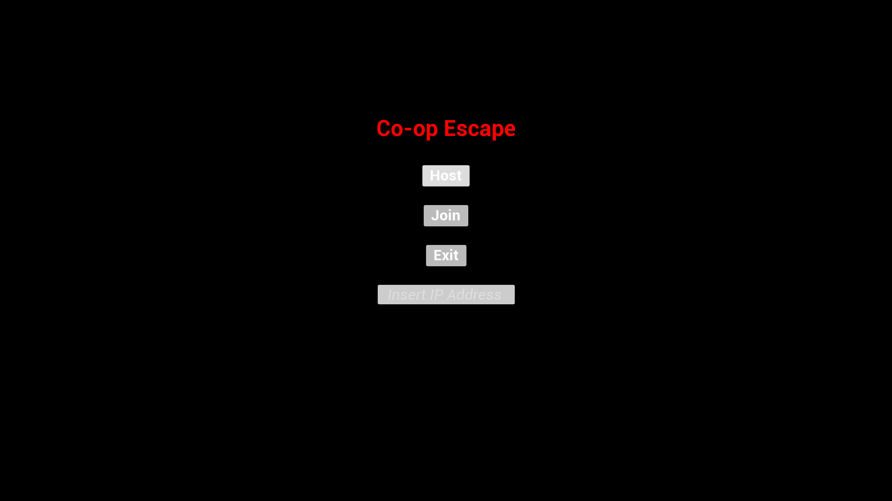
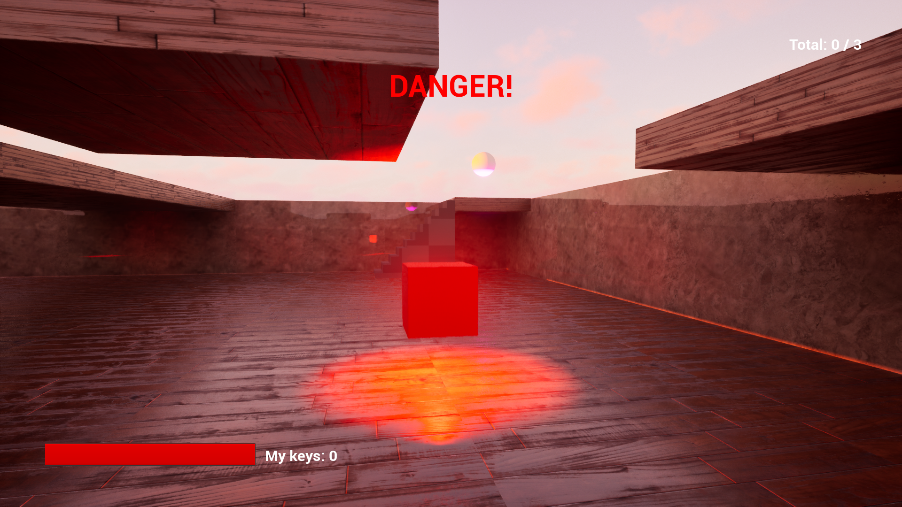
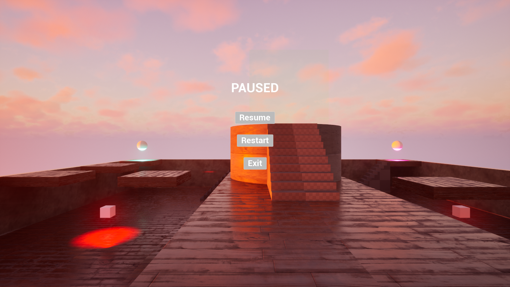

[Русская версия](README_RU.md)

# Co-op Escape

A cooperative multiplayer game for 2–4 players, built with Unreal Engine 5 for my portfolio.

## What it is

Two to four players must collect 3 keys on the arena while avoiding smart hazards, then reach the extraction zone. The game is won when all keys are collected and all players are in the extraction zone.

## Controls

- WASD — movement
- Mouse — camera
- Space — jump
- ESC — pause

## Features

- Multiplayer for 2–4 players (Listen Server)
- Character, movement, and health replication
- Server-authoritative pickup system (keys, medkits)
- Smart hazards that chase the closest player
- Damage and heal synchronization
- Per-player HUD (health, personal keys, total keys, danger warning)
- Notifications ("Need X more keys!", "Waiting for other players...")
- Networked pause menu (shown for all players)
- Win/lose screen for all players
- Level restart
- Visual effects (red flash on damage, green flash on heal)
- Main menu (Host / Join / Exit)

## Tech

Unreal Engine 5.6, C++ (core logic), Blueprint (UI), Enhanced Input, Replication, RPC (Server, Client), DataAsset (hazard tuning), Git.

## Screenshots and Video

[Gameplay video on YouTube](https://youtu.be/lmssMdeIZzE) — 2 minutes, shows Host, Join, core gameplay.

## Download

[Google Drive link](https://drive.google.com/file/d/1K9KfCqLFGEE51t5C8LbicqSssrENspqH/view?usp=sharing)

**Platform:** Windows 64-bit  
Unzip the archive and run `CoopEscape.exe`.

**How to play:**
1. Run `CoopEscape.exe` on the first PC → **Host**.
2. Run `CoopEscape.exe` on the second PC → **Join** → enter the first PC's IP (e.g., `192.168.1.10`).

## Known Limitations

- Listen Server only (no Dedicated Server).
- No Host Migration when the host disconnects.
- Windows 64-bit only.

## Contact

GitHub: [EduardNarezhnev](https://github.com/EduardNarezhnev)